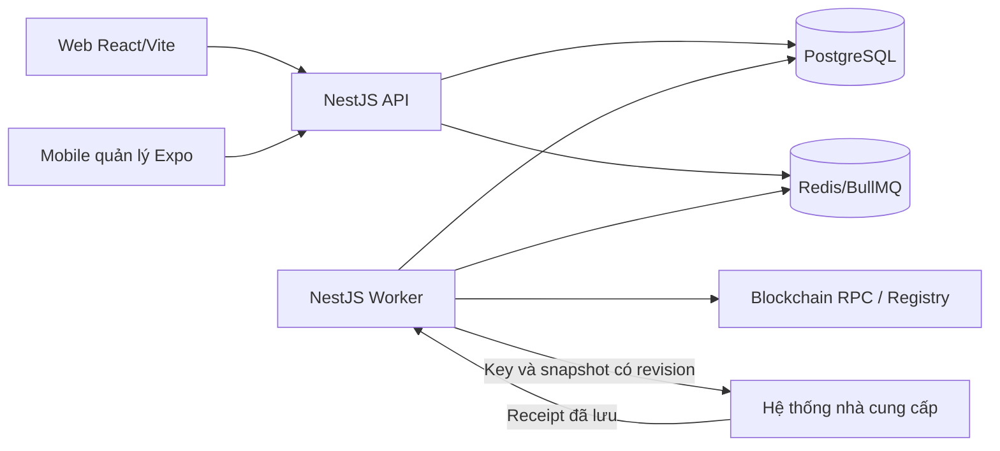

# Công nghệ và kiến trúc EmuKey — baseline v5.1-r5

> Cập nhật 04/11/2026 theo mô hình bàn giao key cho hệ thống nhà cung cấp. Tài liệu mô tả cấu trúc và trách nhiệm; không tự chứng minh đã triển khai dịch vụ thật. Schema và mã nguồn có thẩm quyền cao hơn số liệu lịch sử.

## 1. Thành phần thuộc đồ án

- Web: React, Vite, Ant Design, TanStack Query.
- Mobile quản lý: React Native + Expo, cùng tài khoản/backend với web.
- Backend: NestJS modular monolith; API và worker là hai process dùng chung application/domain và PostgreSQL.
- PostgreSQL external: dữ liệu nghiệp vụ, key ciphertext, outbox, receipt và chain projection. Explicit SQL qua pg, không ORM/schema sync.
- Redis/BullMQ: queue, cache, rate limit và hạ tầng xử lý nền; không giữ bản duy nhất của key hoặc việc bàn giao.
- Blockchain/Sepolia: relayer, command, event/indexer, confirmation/reorg và bằng chứng lifecycle; không nhận secret key.
- Hệ thống nhà cung cấp: bên ngoài ranh giới EmuKey, nhận key qua HTTPS, lưu whitelist và kiểm tra quyền sử dụng trong sản phẩm.

## 2. Module và tích hợp

Giữ Identity & Access, Catalog & Plan, Commerce & Payment, Licensing, Blockchain, Assistance & Support, Operations. Licensing sở hữu provider integration và bàn giao. Commerce gọi application writer để lưu key cùng payment/license/command. Blockchain gọi application boundary để ghi snapshot cùng transaction cập nhật projection. Không gọi HTTP nhà cung cấp trong DB transaction.

SePay, Cloudinary, Brevo, Gemini, FCM và blockchain RPC nằm sau adapter backend. Tích hợp nhà cung cấp là adapter outbound tương tự, có contract versioned, timeout, receipt, retry và phân quyền cấu hình. Worker đọc outbox PostgreSQL; BullMQ poller có thể phục hồi sau mất queue.

Runtime/build/deploy nằm trong `EmuKey/`. Tooling/fixtures/tests của workspace không trở thành dependency của product. Docker Compose và GitHub Actions giữ cấu trúc hiện có. Phiên bản cụ thể lấy từ package.json/lockfile, không sao chép một danh sách phiên bản dễ lỗi thời vào kiến trúc.

## 3. Key và credential

Key ngẫu nhiên 32 bytes từ Node crypto, commitment theo protocol hiện hành. Secret mã hóa AES-256-GCM trong PostgreSQL với AAD gắn license/key version. Token cấu hình cũng mã hóa, nhưng là credential giữa hai máy chủ, không phải khóa ký license.

Khóa mã hóa lấy từ cấu hình bí mật hiện hành, có encryption key ID và phải backup cùng chính sách vận hành. Thay khóa mã hóa không được làm mất khả năng đọc ciphertext cũ; phải di chuyển ciphertext có kiểm chứng trước khi bỏ khóa cũ. Không nhúng khóa lưu trữ hoặc token nhà cung cấp vào web/mobile của người mua.

Không bổ sung chữ ký số cho license. Chữ ký transaction blockchain và bảo vệ TLS vẫn là cơ chế hạ tầng hiện có. Key hợp lệ vì tồn tại trong whitelist được đồng bộ và gắn đúng sản phẩm/trạng thái/thời hạn, không vì ứng dụng giải mã chuỗi key theo quy luật.

## 4. Lưu trữ và trạng thái

Schema duy nhất `EmuKey/backend/database/schema.sql`: 24 bảng, gồm provider_integrations, license_key_materials và provider_license_deliveries mới. Schema_versions kiểm soát upgrade có fingerprint. License_key_deliveries là receipt nhận key của người mua.

Delivery dùng lease token, revision và receipt. Có thể gửi nhiều lần ở transport, nhưng upsert/receipt phía nhận phải idempotent. ACK phiên bản cũ không làm phiên bản mới thành công. Người mua chỉ nhận key sau chain trust và provider ACK hiện hành.

Mode LEGACY_DEVICE giữ dữ liệu/quy trình trước cutover. Mode PROVIDER_HANDOFF dùng cho đơn mới và không cấp device proof/entitlement tại EmuKey. Giới hạn thiết bị trong gói là quyền lợi do bên bán thực thi; không hiển thị số thiết bị sử dụng giả định bằng 0.

## 5. Client và nguồn API

Web và mobile quản lý dùng OpenAPI sinh từ backend. Bản OpenAPI đầu vào của mỗi client phải khớp backend, generated types do script sinh, HTTP wrapper/auth store/query cache tái sử dụng owner hiện hành.

Trang provider có tab Tích hợp và lịch sử bàn giao. Buyer thấy payment, issuance và provider delivery riêng, nhận mã một lần và quay về đơn hàng. System/support xem metadata theo role. Máy chủ của bên bán, không phải client EmuKey, nhận token kết nối.

## 6. Kiểm thử và giới hạn bằng chứng

Unit kiểm tra policy, integration dùng PostgreSQL/receiver DB riêng, HTTP contract kiểm tra role/ownership, web tests kiểm tra state và điều hướng. Test fixture nhận key là công cụ kiểm chứng độc lập, không là một application delivery unit của đồ án.

Mất kết nối bên bán khiến cập nhật quyền bị chậm; giao diện phải thể hiện pending sync. Không hỗ trợ xác thực license ngoại tuyến hoặc hứa thu hồi tức thì khi hệ thống nhận mất mạng. Kết quả SePay/Sepolia thật có ngày là bằng chứng cho đúng phiên bản/lần chạy đó, không thay test luồng bàn giao mới.
