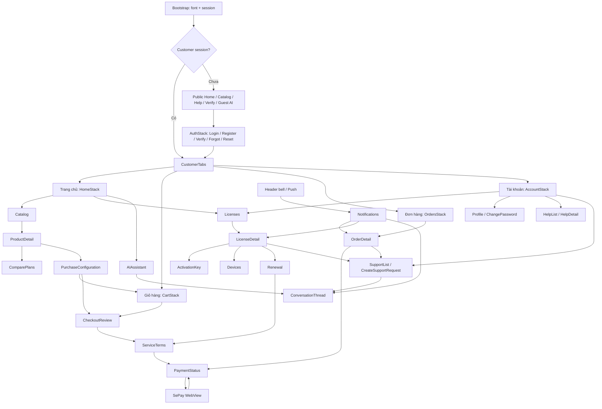

# EmuKey Android Customer — Báo cáo UI/UX và kế hoạch thiết kế lại

Ngày khảo sát: **18/11/2026**. Trạng thái: **đề xuất để triển khai ở bước tiếp theo; chưa sửa code ứng dụng**.

> Dành cho Codex triển khai: đọc tài liệu này cùng `AGENTS.md`, dùng `executing-plans` và các skill theo phạm vi. Không tự commit, push, thay schema hay giao việc cho subagent. Từng checkbox là công việc tương lai, không phải việc đã hoàn thành trong lần khảo sát này.

**Mục tiêu:** ứng dụng Android chỉ dành cho Customer, đồng nhất thương hiệu Web, điều hướng native rõ ràng, tương đương nghiệp vụ Customer và bảo toàn các cơ chế bảo mật/thanh toán hiện tại.

**Kiến trúc đề xuất:** giữ React Navigation native stack và API client hiện hữu; thêm bottom tabs, tách presentation theo chức năng, đưa điều phối state ra application hooks. Theme native ánh xạ từ theme Web, không import Ant Design/CSS hoặc thư mục frontend vào mobile runtime.

**Stack đọc từ manifest:** Expo `~57.0.33`, React Native `0.86.3`, React `19.2.3`, React Navigation native `7.3.18`, native-stack `7.18.10`, safe-area-context `5.7.0`, WebView `13.16.1`, expo-font `~57.0.4`, SecureStore và Notifications. Web dùng Ant Design `6.6.2`, TanStack Query `5.102.8`. Đây là phiên bản khai báo; chưa xác nhận toàn bộ package cài thực tế hoặc tương thích binary bằng build.

## 1. Phạm vi và độ tin cậy của báo cáo

- Khảo sát source UI Mobile, entrypoint/config/dependencies, API client, device identity, generated contract liên quan và các test Mobile hiện có.
- Đối chiếu route Customer/public trên Web, theme/CSS, screen, purchase modal, notification center, assistant, support, auth và application query tương ứng. Chỉ xem phần Customer của component dùng chung nhiều role.
- Kiểm tra thêm controller commerce, identity và assistance khi cần xác nhận endpoint đã tồn tại. Không audit toàn bộ backend trong tài liệu UI này.
- Đây là **đánh giá tĩnh dựa trên code**, chưa chạy emulator, chưa đo FPS, chưa thử bàn phím/TalkBack, chưa chứng nhận giao diện qua ảnh render. Các nguy cơ layout được ghi là suy luận từ cấu trúc, không phải lỗi đã tái hiện trên thiết bị.
- Root Git sạch lúc bắt đầu; nested Git `EmuKey/` có nhiều thay đổi có sẵn, gồm Mobile và AI/support Web/backend. Báo cáo dựa trên working tree đang có, không chỉ HEAD. Không ghi đè hay dọn các thay đổi đó.
- File `frontend/src/presentation/screens/tmpot6gg5p2.tmp` có sẵn trong inventory; không dùng làm nguồn sản phẩm và không xóa trong nhiệm vụ này.
- “Có” trong ma trận nghĩa là tìm thấy implementation/call site; không đồng nghĩa đã chạy test hoặc đã hoạt động trên production. “Thiếu” nghĩa là không tìm thấy surface/call trong phạm vi Mobile đã khảo sát.

### 1.1. Danh mục nguồn code

Các đường dẫn trong bảng tính từ root repository. Dùng mã nguồn bên dưới để truy vết các kết luận và yêu cầu trong toàn tài liệu; số dòng là mốc khảo sát, có thể thay đổi sau khi tách file.

| Mã | File / symbol gốc | Nội dung kiểm chứng |
|---|---|---|
| M1 | `EmuKey/mobile/src/presentation/EmuKeyMobileApp.tsx` | Toàn bộ màn hình, navigator và styles; khoảng 1.260 dòng |
| M2 | `EmuKey/mobile/src/infrastructure/api/client.ts` | Auth Customer, session/refresh, API, key receipt, push, idempotency |
| M3 | `EmuKey/mobile/App.tsx`, `app.json`, `package.json` | Entry, portrait, scheme `emukey`, package Android, dependencies |
| M4 | `EmuKey/mobile/src/infrastructure/api/generated/types.gen.ts` | DTO sinh từ OpenAPI; không tự sửa |
| M5 | `EmuKey/mobile/src/infrastructure/device-identity.ts` | Khóa thiết bị, ký challenge; không phải lý do để thêm UI activation vào customer app |
| W1 | `EmuKey/frontend/src/presentation/theme.ts`, `styles.css`, `src/main.tsx` | Palette, typography, brand, style Web |
| W2 | `EmuKey/frontend/src/presentation/app/App.tsx`, `components/CustomerLayout.tsx`, `components/SiteHeader.tsx` | Route và quyền, navigation, header |
| W3 | `EmuKey/frontend/src/presentation/screens/BuyerHomeScreen.tsx`, `src/domain/buyerHome.ts` | Metrics, sắp hết hạn 30 ngày, shortcuts |
| W4 | `EmuKey/frontend/src/presentation/screens/CatalogScreen.tsx`, `ProductDetailScreen.tsx`, `ComparePlansScreen.tsx` | Catalog, ảnh, sort, chi tiết, so sánh |
| W5 | `EmuKey/frontend/src/presentation/components/PurchaseFlowModal.tsx`, `OrderSummary.tsx`; `screens/BuyerCheckoutScreen.tsx`; `src/application/orders/checkoutIntent.ts` | Cấu hình mua, điều khoản, snapshot, resume |
| W6 | `EmuKey/frontend/src/presentation/screens/BuyerOrdersScreen.tsx`, `PaymentStatusScreen.tsx`, `BuyerRenewalScreen.tsx`; `src/application/orders/orderQueries.ts` | Lọc/hủy/xuất đơn, payment history/retry, renewal |
| W7 | `EmuKey/frontend/src/presentation/screens/BuyerLicenseHubScreen.tsx`; `components/LicenseRecoveryPanel.tsx`, `LicensingEmailActionPanel.tsx`, `ProviderHandoffNotice.tsx`; `src/application/licenses/licenseQueries.ts` | License, key, device, email action, bàn giao |
| W8 | `EmuKey/frontend/src/presentation/screens/AuthScreen.tsx`, `AccountProfileScreen.tsx`; `components/AuthForms.tsx`; `src/application/auth/authContext.tsx` | Register/verify/reset/change password/profile |
| W9 | `EmuKey/frontend/src/presentation/components/NotificationCenter.tsx`; `src/application/notifications/notificationQueries.ts` | Badge server, phân trang và mark read |
| W10 | `EmuKey/frontend/src/presentation/components/AiAssistantLauncher.tsx`, `ConversationPanel.tsx`; `screens/BuyerAssistanceScreen.tsx`; `src/application/assistance/assistanceQueries.ts`, `supportQueries.ts` | AI authenticated/guest, recommendation, support context, history |
| W11 | `EmuKey/frontend/src/presentation/screens/PublicHelpScreen.tsx`, `PublicHelpDetailScreen.tsx`, `PublicVerificationScreen.tsx`; `src/application/assistance/knowledgeQueries.ts` | Help search/filter/detail, xác minh và lịch sử blockchain |
| B1 | `EmuKey/backend/src/modules/commerce-payment/presentation/commerce.controller.ts` | Orders, service-terms, checkout, retry, cancel |
| B2 | `EmuKey/backend/src/modules/identity-access/identity.controller.ts` | Register/verify/reset và auth routes |
| B3 | `EmuKey/backend/src/modules/assistance-support/assistance-support.controller.ts`, `assistance-support.dto.ts` | Customer conversation, AI, escalation, guest history; queue chỉ cho staff/admin |
| T1 | `tests/emukey/mobile/unit/app.test.tsx`, `phase3-phase4-screens.test.tsx`, `license-screens.test.tsx`, `api-client.test.ts` | Regression đang có cho session, commerce, key, chat |
| T2 | `tooling/emukey/verification/jest.mobile.config.cjs`, `tests/emukey/e2e/mobile/phase6-license-flow.yaml` | Jest và flow Maestro hiện có |

### 1.2. Điều chỉnh so với hướng dẫn lịch sử

Skill `license-platform-builder/references/domain-invariants.md` còn mô tả ký hợp đồng và không có giỏ MVP. Source hiện tại W5/B1/M1 dùng **tạo đơn → đồng ý service terms đúng version/hash → thanh toán → cấp/gia hạn license**. Kế hoạch theo code này; không thêm ký tay, chữ ký số, upload hợp đồng hoặc màn hình contract không có trong flow Customer hiện tại.

Giỏ hàng là yêu cầu mới của thiết kế, không phải tính năng Web đang có. Không coi việc thêm tab là quyền thiết kế lại transaction hoặc tạo batch checkout.

## 2. Đánh giá Mobile hiện tại

### 2.1. Inventory đầy đủ các surface hiện có

| Surface / mốc trong M1 | Hiện trạng | Định hướng |
|---|---|---|
| `LoginScreen` ~103 | Login, forgot mode, public verification; native Button/TextInput | Auth stack, field label, password visibility, pending/error rõ |
| `CustomerNavigation` ~151 | 6 Button wrap trong nội dung; chỉ được nhúng tại một số màn | Thay bằng shell có 4 bottom tabs và header notification |
| `AssistanceScreen` ~179 | Danh sách hội thoại nằm trên tin nhắn; composer ở footer FlatList; AI/human chung màn | Tách list, create request, thread; composer ngoài list |
| `MobileKnowledgeCitations` ~390 | Nguồn AI và mở chunk inline | Citation chip → sheet/reader, giữ quyền truy cập |
| `NotificationsScreen` ~407 | Phân trang, refresh, mark read, mở target | Virtualized feed, unread badge chung, error theo thao tác |
| `CatalogScreen` ~457 | Tìm kiếm; mọi gói nằm ngay dưới mỗi sản phẩm; compare 2–4 | Product cards → product detail; sort và compare tray |
| `ComparePlansScreen` ~529 | Card từng gói với dimensions, CTA mua | So sánh theo thuộc tính, chọn 2–4, mua đúng plan |
| `ProfileScreen` ~606 | Tên, phone, address, email readonly; feedback text | Tách Account hub và Edit profile; dirty/pending/validation |
| `OrdersScreen` ~654 | Danh sách cơ bản và refresh, không search/filter/cancel/export | Order cards + chips + search + actions theo trạng thái |
| `CheckoutScreen` ~679 | Tạo/mở đơn, tải terms, consent rồi payment | Cấu hình, review snapshot, terms riêng; giữ idempotency |
| `PaymentScreen` ~803 | SePay HTML POST trong WebView; polling; trust/provider handoff/renewal | Native status timeline, gateway giữ WebView, không tự kết luận thanh toán |
| `LicensesScreen` ~914 | List, chi tiết, key và device gộp trong card; email actions | List → detail → key/device; giữ khác biệt fulfillment mode |
| `RenewalScreen` ~1015 | Preview, pending order, terms, payment | Review hạn/giá, resume đúng đơn, reuse commerce UI |
| `VerifyLicenseScreen` ~1110 | Public ID → product/state/id | Bổ sung thông tin xác minh từ DTO, lịch sử có dữ liệu |
| `OrderDetailScreen` ~1144 | View không scroll; basic snapshot; support context theo order | Scrollable detail, provider, entitlement, time, progress |
| `EmuKeyMobileApp` ~1170 | Restore session, font, push, linking, 12 native-stack routes | Composition root nhỏ, session + route adapters riêng |
| `styles` ~1226 | Khoảng 30 styles dùng chung, hex rải, nền kem/đỏ nâu | Native semantic tokens và components |

### 2.2. Điểm tốt cần bảo toàn

1. M2 có Customer role check khi login/restore/refresh, SecureStore, session generation và chống response từ account cũ.
2. M1/M2 có create-order idempotency, order snapshot từ server, terms version/hash và chặn payment khi chưa tải terms.
3. Payment kiểm tra retry decision, dùng signed POST, nhận return link rồi đọc backend; đã phân biệt payment accepted với license ready.
4. Key được lưu vào SecureStore trước acknowledge; receipt gắn user/license/keyVersion, có retry ack. Web chỉ giữ mã trong memory là khác biệt nền tảng có chủ đích, không được “đồng bộ UI” bằng cách làm mất bảo đảm lưu của Mobile.
5. Provider handoff không hiển thị quản lý device nội bộ; trust/finality và delivery status đang được xét.
6. Chat đã có dedup, cursor/serverSequence, request generation, giữ draft và reuse clientMessageId khi retry; polling dừng khi background ở một số luồng.
7. Có test regression cụ thể cho stale verification, terms fail, snapshot price, payment uncertainty, signed POST, AI unavailable, history pagination và email-bound action.

### 2.3. Vấn đề và mức ưu tiên

| Mức | Bằng chứng | Ảnh hưởng / việc cần làm |
|---|---|---|
| P0 | M1 dùng `#f3f0e9`, `#fdfbf6`, `#7a2e3a`, giá `#8a611f`; W1 dùng canvas xanh xám và primary xanh | Lệch thương hiệu rõ; thay semantic theme toàn app |
| P0 | Không có bottom tab, Home hoặc ProductDetail route; navigation trong ScrollView | Không có cấu trúc tác vụ bền vững; thêm shell và IA mới |
| P0 | M1 không có app-level SafeAreaProvider/KeyboardAvoidingView; safe-area dependency có trong manifest | Chưa có chiến lược insets cho auth/custom content/composer. Native header có xử lý riêng nên không kết luận mọi màn đang chồng status bar |
| P0 | Checkout chỉ gửi `{planId}`, W5 có deviceQuantity/durationMonths | Thiếu parity mua cấu hình tùy chỉnh |
| P0 | Hầu hết UI/state/network/styles trong M1 | Refactor dễ làm mất guard và tạo side effect; tách theo lát nhỏ có regression |
| P1 | Nhiều danh sách `ScrollView` + `.map`; chat đã dùng FlatList | Danh sách dài có nguy cơ tốn bộ nhớ; virtualize theo dữ liệu thực |
| P1 | Catalog loading không có skeleton; licenses hiển thị empty ngay khi chưa tải xong; error/retry không thống nhất | Dễ nhầm “không có dữ liệu”; có state model dùng chung |
| P1 | Profile không có pending lock; field chỉ có accessibilityLabel; bỏ field rỗng khỏi payload | Có nguy cơ submit lặp và không xóa được phone/address; kiểm tra contract, gửi empty đúng như Web |
| P1 | Chat composer là ListFooterComponent, selector hội thoại chiếm phần đầu | Nguy cơ thao tác nhiều bước và bị keyboard che; tách màn, composer fixed |
| P1 | Mỗi `CustomerNavigation` có polling riêng 15 giây, mark-read tại screen không cập nhật trực tiếp count của shell | Badge có thể chậm/duplicated polling; một owner notification state |
| P1 | M1 hiển thị raw finality/confirmationCount/state và nhiều CTA ngang | Người mua phải hiểu chi tiết kỹ thuật; summary ngôn ngữ nghiệp vụ, technical details mở thêm |
| P1 | Order detail không scroll, planRow chứa nhiều control theo hàng ngang | Nguy cơ overflow ở máy nhỏ/font lớn; vertical stacking và scroll |
| P2 | Thiếu hệ icon thống nhất, money/date/label rải ở màn | Khó duy trì consistency; semantic icon và formatter/status selectors |

Không gán điểm usability, tỷ lệ conversion hoặc tốc độ giả định khi chưa đo. Những mục trên cần QA thực tế trước khi kết luận release-ready.

## 3. Ma trận parity Web / Mobile

Ký hiệu: **Có**, **Một phần**, **Thiếu**, **Mới**. P0 = nền móng/luồng tiền và quyền; P1 = bắt buộc hoàn thiện trước tuyên bố parity Customer; P2 = chất lượng và tiện ích. Các hạng mục P2 vẫn phải hoàn tất nếu tuyên bố parity đầy đủ.

| ID | Nghiệp vụ Customer | Web đã kiểm chứng | Mobile hiện tại | Bổ sung/giữ lại | Ưu tiên |
|---|---|---|---|---|---|
| F01 | Login/logout/restore/refresh | W8 | Có M1/M2 | Giữ mobile auth endpoints và role gate | P0 |
| F02 | Đăng ký Customer, phân loại khách | RegisterForm, W8 | Thiếu | Register, customerType từ contract; không role picker | P1 |
| F03 | Verify email / resend | AuthScreen W8 | Thiếu | Native waiting/resend; email link dùng Web đang có trước, mở native khi link verified | P1 |
| F04 | Forgot / reset | W8 | Forgot có; reset native thiếu | Reset form, link expired và request new link | P1 |
| F05 | Đổi mật khẩu | Profile W8 PUT `/auth/password`, logout sau thành công | Thiếu | Current/new/confirm, clear session đúng contract | P1 |
| F06 | Hồ sơ | W8 | Có cơ bản | Dirty/pending/errors, xóa field optional đúng API | P1 |
| F07 | Trang chủ Customer | W3 metrics/shortcuts | Thiếu; login vào catalog | Home native từ orders/licenses; unknown device count không hiển thị 0 | P0 |
| F08 | Catalog public/customer | W4 | Có nhưng bị login gate | Public browse như Web; private actions yêu cầu login | P1 |
| F09 | Search/sort/catalog paging | W4 search, price asc, page size 12 phía client | Search có, sort/paging UI thiếu | Search/sort + render list; không giả định API paginated | P1 |
| F10 | Product detail/artwork/entitlements | W4 | Thiếu màn riêng | ProductDetail, plan choice, native artwork fallback | P0 |
| F11 | Compare 2–4 plans | W4 | Có | Giữ dimension contract, thay bố cục và cho chỉnh selection | P1 |
| F12 | Giỏ hàng | Không tìm thấy cart route/store/API trong phạm vi khảo sát | Thiếu | Tính năng **mới**, draft local, mua từng cấu hình | P0 |
| F13 | Tùy chỉnh số thiết bị/tháng | W5: integer 1..2147483647, tháng 1/2/3/6/12 | Thiếu UI; createOrder nhận DTO | Form configuration và server snapshot review | P0 |
| F14 | Tạo đơn/resume/terms | W5/W6 | Có; thiếu UX resume bền vững như checkout intent Web | Giữ orderId sau tạo, terms retry không tạo lại đơn | P0 |
| F15 | SePay và retry decision | W5/W6 | Có M1/M2 | Native status + giữ WebView signed POST | P0 |
| F16 | Payment review/history | PaymentStatus W6, `/payments/history` | Một phần; có retry decision nhưng không có history call/UI | Hiển thị evidence cần kiểm tra, support context đúng order | P1 |
| F17 | Orders list/detail | W6 | Có basic | Provider/snapshot/entitlements, due time, license progress | P0 |
| F18 | Search/filter order | W6 | Thiếu | Chips theo trạng thái, search mã/sản phẩm/gói | P1 |
| F19 | Hủy đơn | W6/B1 POST `/orders/:id/cancel` | Thiếu cả wrapper và UI | Confirm, backend quyết định, 409 refresh | P1 |
| F20 | Xuất CSV orders | W6 xuất tập dữ liệu đã lọc | Thiếu | Export/share native trong overflow, đủ escaping và bảo vệ dữ liệu account | P2 |
| F21 | License list/detail/search/filter | W7 | List có; detail gộp; search/filter thiếu | List và detail riêng, filter ACTIVE/expiring/pending/expired/suspended/revoked | P1 |
| F22 | Nhận/xem/copy key | W7 one-time + ack, memory | Nhận/xem SecureStore + auto ack; copy chưa có CTA | Giữ receipt; reveal/copy an toàn, không đưa key vào params/cache chung | P0 |
| F23 | Recovery/rotate qua email | W7 | Có email → Web → app | Giữ boundary, status return rõ; không bắt nhập token thủ công | P0 |
| F24 | Device list/rename/revoke | W7 | Có khi không provider-managed | Device screen, name validation, email revoke, giữ policy | P1 |
| F25 | Provider handoff visibility | W7 | Có logic trong M1 | Progress component, không thêm Provider UI | P0 |
| F26 | Renewal thủ công | W6 | Có | Preview/current/new expiry; pending order; refresh finality | P0 |
| F27 | Notification feed/unread/read/paging/target | W9 | Có, nút trong content | Header bell chung, realtime UI count sau read; push đã có giữ nguyên | P0 |
| F28 | AI authenticated/citations | W10 | Có trong Assistance | AI screen rõ ràng, sources, không duplicate answer | P1 |
| F29 | AI catalog recommendation / product actions | W10 metadata và nguồn catalog | Message type/UI M2/M1 chưa render catalogSources/recommendations | Cards → ProductDetail/Compare; revalidate trước mua | P1 |
| F30 | Guest AI và nhập lịch sử có consent | W10 public ask + linkGuestHistory | Thiếu | Bổ sung nếu hoàn thành public parity; explicit consent theo Web | P2 |
| F31 | Support list/thread/history/handoff | W10 | Có, history và retry khá đầy đủ | UI list/thread riêng, giữ cursor/dedup/drafts | P1 |
| F32 | Tạo support request có mô tả và context | W10 `mode:SUPPORT`, initialMessage, clientRequestId, GENERAL/ORDER/LICENSE/PRODUCT/PLAN | createConversation chỉ title/orderId; mode/form chưa parity | Form + typed request input qua API client hiện hữu | P1 |
| F33 | Đóng hội thoại | API/Mobile close; Web thread read-only khi CLOSED | Có M1 | Confirm nhẹ, guard pending và cập nhật thread | P1 |
| F34 | Help list/search/tag/product/detail/related | W11 | Thiếu, chỉ có citation chunk | Knowledge reader native, không knowledge management | P1 |
| F35 | Public license verification | W11 | Có basic state/product/id | Bổ sung overview/history/chi tiết event từ DTO; giữ privacy | P1 |

**Không đưa vào scope:** provider onboarding/invitation/catalog publishing, key stock, queue claim/release của Support Staff, AI knowledge admin, admin payment review, blockchain operations, activation-code claim hoặc license-client demo. `PROVIDER_HANDOFF` chỉ là dữ liệu trạng thái Customer cần biết.

**Không giả định có:** coupon, wishlist, review/rating, flash sale, wallet, refund request của Customer, attachment chat, biometric login, dark theme, offline payment, server cart, multi-order payment hoặc push preferences API. Nếu cần về sau, lập yêu cầu riêng và xác minh contract.

## 4. Quyết định UX và điều hướng

### 4.1. So sánh phương án

| Phương án | Lợi ích | Đánh đổi | Quyết định |
|---|---|---|---|
| A. Trang chủ / Giỏ hàng / Đơn hàng / Tài khoản | Đúng yêu cầu, mua hàng dễ hiểu, 4 đích ổn định | Giỏ là chức năng mới; license cần shortcut tốt | **Baseline của kế hoạch** |
| B. Trang chủ / Bản quyền / Đơn hàng / Tài khoản; giỏ ở header | Phù hợp tác vụ sau mua, license có mặt thường trực; hiện đã có business support | Khác yêu cầu 4 nhãn; chưa có dữ liệu sử dụng chứng minh license thường xuyên hơn cart | Chỉ cân nhắc khi người dùng chọn lại IA, không tự thay |
| C. 5 tabs gồm Sản phẩm/Bản quyền/Đơn hàng/Giỏ/Tài khoản | Mọi tác vụ dễ thấy | Chật nhãn tiếng Việt, ít ưu tiên, mất Home định hướng | Không chọn |

Không dùng drawer chính, dashboard admin thu nhỏ, nút điều hướng lặp trong mỗi page hoặc floating AI che CTA mua hàng.

### 4.2. Bottom navigation và Header

- Bốn tab cố định về vị trí/thứ tự: **Trang chủ · Giỏ hàng · Đơn hàng · Tài khoản**. Icon kèm nhãn luôn hiện; active màu primary và nền info, không chỉ đổi màu icon.
- Bell đặt phải Header các màn chính; count chính xác từ `unreadCount`, UI `99+` nhưng accessibility đọc số thực. Không hiển thị badge 0. Guest ẩn bell.
- Tab cart badge là số cấu hình lưu, không phải tổng thiết bị. Không tạo badge orders nếu chưa định nghĩa dữ liệu đếm có ý nghĩa.
- Tab bar nằm ngoài list, không cuộn theo trang. Chiều cao nội dung mục tiêu 64 dp cộng bottom inset, được phép tăng khi font scale lớn; mỗi hit area ít nhất 48 dp.
- Stack trong mỗi tab bảo toàn scroll/filter. Nhấn lại tab đang chọn đưa về root của tab; ở root nhấn lại có thể scroll top khi danh sách đã có dữ liệu.
- Root stack overlay dành cho payment gateway, auth, notification, license/knowledge chi tiết và thread toàn màn hình. **Tab bar vẫn cố định ở bốn khu vực chính; ẩn có chủ đích ở gateway, auth và conversation thread** để tránh đổi tác vụ giữa giao dịch/composer. Đây là ngoại lệ UX đề xuất, không render tab đè lên cổng thanh toán.
- Android Back: đóng sheet/keyboard trước; sau đó pop screen; từ root tab khác về Home; từ Home giao hành vi thoát cho Android, không tự logout. Back từ payment chỉ đóng gateway và refetch order, không hủy đơn.

### 4.3. Sơ đồ route đề xuất



Public browse là parity cần bổ sung; không đồng nghĩa cho guest đọc orders/licenses. Guest nhấn mua sẽ login rồi khôi phục **selection**, không tự tạo order hay đồng ý terms. Tài khoản khác role hiển thị “Ứng dụng dành cho khách hàng” và thoát phiên; không tạo navigator privileged.

### 4.4. Route payload và tương thích

| Route mới | Params | Owner / hành vi |
|---|---|---|
| `CustomerTabs` | tab và nested screen được type hóa | Một NavigationContainer |
| `ProductDetail` | `productId` | Fetch public data; không truyền object lớn |
| `ComparePlans` | `ids: string[]` (2–4) | Giữ contract cũ |
| `PurchaseConfiguration` | `productId`, `planId?`, `draftId?` | Chưa tạo order |
| `CheckoutReview` | `draftId?`, `orderId?` | Có orderId thì fetch/resume; không tin route price |
| `ServiceTerms`, `Payment` | `orderId` | Terms bind theo ID/version/hash |
| `OrderDetail` | `id` | Giữ tên/ID để giảm migration |
| `Licenses` | `licenseId?`, `filter?` | Link cũ có licenseId chuyển sang detail đúng owner |
| `LicenseDetail`, `ActivationKey`, `Devices` | `licenseId` | Không truyền key/token/password |
| `Renewal` | `licenseId` | Adapter tạm nhận originOrderId/productName cũ, data mới lấy API |
| `ConversationThread` | `conversationId` | Auth + ownership trước render |
| `CreateSupportRequest` | `contextType`, `contextId?` | Enum contract, không tùy tiện URL arbitrary |
| `HelpDetail` | `documentId` | Public detail endpoint |

Giữ `emukey://licenses` và `emukey://payment/:orderId`, giữ `matchesPaymentReturn` và pending licensing action. Kiểm thử `licenses?licenseId=...`, cold/warm start, app background, notification pending lúc login, account switch. Chỉ map notification `ORDER/LICENSE/CONVERSATION` đã xác nhận. `PAYMENT` không mặc định là orderId vì phía admin có transaction ID; target không hỗ trợ mở notification detail, không đoán route.

## 5. Giỏ hàng: phạm vi rõ để không làm hỏng nghiệp vụ

**Đề xuất baseline:** giỏ là danh sách cấu hình định mua lưu trên thiết bị theo account; mỗi lần checkout một cấu hình, một order, một SePay session. Copy phải hiện rõ “Thanh toán từng gói”. Không có “Thanh toán tất cả”, không cộng các đơn thành một transaction.

- Draft gồm `id`, `ownerUserId`, `productId`, `planId`, `deviceQuantity`, `durationMonths`, `createdAt`, `updatedAt`, `orderId?`. Có thể lưu label/giá tham khảo để render nhanh, nhưng không làm giá thanh toán.
- Cùng product/plan/devices/months: cập nhật dòng đã có, không tự tăng quantity vì quantity trong domain là thiết bị, không phải số bản sao license.
- Chỉ tạo order sau explicit “Xác nhận cấu hình”; thêm/sửa/xóa giỏ không gọi POST orders.
- Sau create thành công, gắn orderId vào intent trước khi chuyển terms. Sau timeout retry cùng intent idempotency; sau response đã biết orderId luôn resume bằng GET, không create lại.
- Draft đã có order: hiển thị “Đơn đã tạo — tiếp tục” và chuyển orders. Xóa draft **không hủy order**; UI giải thích, hành động hủy nằm ở order detail.
- Gói mất công bố: giữ dòng cùng cảnh báo “Gói không còn khả dụng”, disable checkout, cho chọn lại/xóa. Khi giá đổi, review lại snapshot và consent, không auto-pay.
- Logout/account switch: clear draft/cache của phiên khỏi memory và storage theo policy; tuyệt đối không đưa draft/account A cho B. Thông báo trước trong copy rằng giỏ chỉ lưu trên thiết bị và được xóa khi đăng xuất.
- Storage cần adapter nhỏ cho dữ liệu không bí mật; ưu tiên đánh giá AsyncStorage khi triển khai. Không dùng SecureStore làm kho danh sách dài. Nếu chưa thêm storage, memory-only chỉ là milestone dev, chưa đạt acceptance giữ giỏ qua app restart.
- Multi-product order hoặc đồng bộ giỏ Web/Mobile cần backend contract/schema riêng, ngoài kế hoạch UI này. Không âm thầm mở rộng scope khi gặp kỳ vọng đó.

## 6. Mobile Design System

### 6.1. Hướng thị giác

Light theme, nền xanh xám nhẹ, card trắng, xanh thương hiệu cho hành động chính, typography rõ. Hạn chế shadow và gradient; nhấn bằng hierarchy và khoảng trắng. Không dùng dữ liệu rating/bestseller/discount giả để làm card “đẹp”.

Kết quả tra skill UI/UX gợi ý minimal/functional phù hợp, nhưng palette/font/hero mặc định của kết quả không phù hợp nguồn Web nên **không áp dụng**. Theme W1 là nguồn thương hiệu chính; spacing native dưới đây là quyết định thiết kế mới, không tuyên bố Web đã có spacing system hoàn chỉnh.

### 6.2. Semantic color tokens

| Token Mobile | Giá trị từ W1 | Dùng cho |
|---|---|---|
| `color.canvas` | `#f7f9fb` | Nền screen |
| `color.surface` | `#ffffff` | Card, header, tab bar, form |
| `color.surfaceSelected` | `#f1f5f9` | Subsection/selection neutral |
| `color.text` | `#1c1c1a` | Nội dung chính |
| `color.textSecondary` | `#4a4844` | Secondary copy |
| `color.muted` | `#5e5b54` | Metadata |
| `color.textDisabled` | `#94a3b8` | Control disabled; không body text |
| `color.border` | `#e2e8f0` | Phân tách/card |
| `color.control` | `#cbd5e1` | Border input; cần focus/label rõ |
| `color.primary` / `primaryPressed` | `#1a4dc7` / `#163fa4` | CTA, active navigation |
| `color.onPrimary` | `#ffffff` | Text trên CTA |
| `color.infoSurface` / `infoText` | `#eef4ff` / `#163fa4` | Active chip, info banner |
| `color.successSurface` / `successText` | `#e7f4ec` / `#1f6f46` | Đã xác nhận |
| `color.warningSurface` / `warningText` | `#fbf0d6` / `#7a5200` | Cần chú ý, pending/review |
| `color.errorSurface` / `errorText` | `#fbeaea` / `#9b2226` | Lỗi/hành động nguy hiểm |

Ánh xạ thêm border semantic cùng W1 khi component cần. Không kéo sidebar đen của admin vào Customer Mobile. Giá dùng text/primary, không vàng nâu như M1. Không dùng màu làm thông tin duy nhất: badge luôn có nhãn/icon.

### 6.3. Typography, spacing, shape

| Nhóm | Đặc tả đề xuất |
|---|---|
| Body font | IBM Plex Sans tương ứng Web; static font weights 400/500/600/700 có glyph tiếng Việt, kiểm tra license và asset trước khi thêm |
| Brand | Great Vibes đã có; chữ đúng `EmuKey`; chỉ wordmark 30/38, không dùng cho giá/title/fields |
| Mono | IBM Plex Mono cho mã nếu thêm asset hợp lệ; fallback Android monospace; không dùng cho toàn UI |
| Page title | 24/32, semibold; detail headline 22/30 khi cần |
| Section / card title | 20/28 và 18/26, semibold |
| Body / input | 16/24 regular; button 16/24 semibold |
| Secondary / caption | 14/20; tab label 12/16, không dùng caption nhỏ cho điều khoản/lỗi |
| Price | 24/32 semibold ở detail; 18/26 ở card |
| Space | 4, 8, 12, 16, 20, 24, 32, 40 dp; page horizontal 16, section gap 24, card padding 16 |
| Radius | Control 8, card 12, sheet 20 phía trên, chip pill; Web token radius 6 là nguồn tham khảo, native tăng có chủ đích |
| Controls | Button/input min-height 48; primary bottom CTA 52; icon 20/24 trong hit target 48 |
| Border/elevation | Border 1; elevation nhỏ cho header/action bar khi scroll; tránh shadow mỗi card |
| Motion | Phản hồi nhấn ngắn, native navigation transition; giảm motion theo accessibility setting, không shimmer vô hạn |

Giữ font scaling hệ thống; không đặt `allowFontScaling=false` để “fix” overflow. Body không truncation; tên sản phẩm tối đa hai dòng trên card, đầy đủ trong detail. Mã dài wrap/selectable theo ngữ cảnh; số tiền không ép một dòng làm vỡ screen.

### 6.4. Icon và assets

Web dùng Ant Design outlined icons. Mobile nên có **một** `AppIcon` semantic wrapper: `home`, `cart`, `orders`, `account`, `bell`, `search`, `filter`, `license`, `device`, `support`, `assistant`, `copy`, `eye`, `chevron`, `close`, `check`, `warning`.

Ưu tiên đánh giá AntDesign subset của thư viện icon tương thích Expo để gần Web; manifest Mobile hiện chưa khai báo thư viện icon trực tiếp. Trước khi chốt package phải kiểm tra exports/glyphs/license/version với SDK 57. Không giả định web `@ant-design/icons` render được trong native; không thêm đồng thời nhiều icon packs. Không dùng emoji làm icon giao dịch.

Ảnh sản phẩm dùng `imageUrl` từ DTO, ratio thống nhất, có fallback brand/initials khi thiếu hoặc lỗi. Các SVG minh họa Web không tự giả định React Native Image đọc được; nếu cần reuse phải có pipeline asset native và license. Không sửa SVG Web trong nhiệm vụ Mobile.

### 6.5. Component contracts và nơi dùng

Tất cả path dưới đây là **đề xuất tạo mới**, không mô tả file đang tồn tại. Gốc `EmuKey/mobile/src/presentation/`.

| File/component | Contract dự kiến | Caller thực |
|---|---|---|
| `theme/tokens.ts` | Semantic colors/type/space/radius; không React/AntD import | Toàn presentation |
| `theme/navigationTheme.ts` | Ánh xạ tokens sang React Navigation theme | Root navigator |
| `components/ui/AppText.tsx` | `variant`, `tone`, native Text props; hỗ trợ scaling | Tất cả màn |
| `components/ui/AppButton.tsx` | `variant: primary/secondary/tertiary/danger`, `loading`, `disabled`, `onPress`, label | Form, CTA |
| `components/ui/AppIcon.tsx` | Semantic name/size/tone, decorative mặc định | Header/tab/card |
| `components/ui/FormField.tsx` | Visible label, helper/error, input props, password toggle | Auth/profile/config/support |
| `components/ui/SurfaceCard.tsx` | Spacing và optional onPress, không business logic | Catalog/order/license/home |
| `components/ui/StatusBadge.tsx` | Label + semantic tone + icon tùy chọn | Orders/license/support |
| `components/ui/FeedbackState.tsx` | Loading/empty/error, title, description, retry/action | Mỗi list/detail |
| `components/ui/InlineNotice.tsx` | Tone, message, action, accessibility announcement | Payment/terms/support |
| `components/ui/ConfirmDialog.tsx` | Title/body/confirm/cancel/pending/danger | Cancel order/logout/close thread |
| `components/layout/Screen.tsx` | `scroll: none/scroll`, keyboard mode, content padding; không bọc FlatList trong ScrollView | Form/detail |
| `components/layout/AppHeader.tsx` | Title/brand/back, bell, trailing action | Root tabs/detail |
| `components/layout/BottomActionBar.tsx` | Price/secondary/primary actions; measured inset | Product/checkout/renewal |
| `components/layout/KeyboardScreen.tsx` | Bố trí list + composer; offset từ header thực | Chat/auth dài |
| `components/NotificationBell.tsx` | Unread từ một notification owner, onOpen | Header |
| `components/ProductCard.tsx` | Public product + onOpen; không tự fetch | Home/catalog/AI recommendation |
| `components/PlanOptionCard.tsx` | Plan + selected/compare callbacks | Detail/config/compare |
| `components/OrderCard.tsx` | Order snapshot + derived CTA | Orders/Home |
| `components/LicenseCard.tsx` | License + derived state/expiry + onOpen | License list/Home |
| `components/KeyValueList.tsx` | Label/value rows adaptive, no table | Order/license/verify |
| `components/FulfillmentProgress.tsx` | View model status từ application/domain selector | Payment/order/license |
| `components/TermsAcceptance.tsx` | Content/version/hash, ready/error, checked/onChange | Checkout/renewal |
| `components/MessageBubble.tsx` | Sender/content/time/metadata, pending state | AI/support thread |
| `components/MessageComposer.tsx` | Draft/onChange/onSend/limit/pending/readOnly | AI/support thread |
| `components/KnowledgeCitations.tsx` | Citation DTO + open handler | AI/thread |
| `components/FilterSheet.tsx` | Controlled selection, apply/reset/cancel | Orders/licenses/help |

Không tạo generic `DataTable`, `DynamicFormBuilder`, service locator, logger/API client thứ hai. Component chỉ nhận dữ liệu/emit intent; selectors quyết định business-derived CTA; backend vẫn thực thi quyền.

## 7. Đặc tả từng màn hình

Các màn đều dùng quy ước: initial loading → content hoặc empty hoặc full-page error; refresh giữ nội dung cũ với cảnh báo stale; mutation pending chỉ khóa vùng liên quan; retry đọc không tạo business mutation mới. Dưới đây bổ sung trạng thái riêng từng màn.

### S01. Bootstrap và Auth

- Bootstrap nền canvas, brand, một loading indicator; lỗi font cho fallback font, không khóa login vĩnh viễn. Session bootstrap hoàn tất trước khi render private content.
- Login: brand nhỏ, “Chào mừng trở lại”, email + password có label, show/hide, quên mật khẩu, primary Đăng nhập, secondary Đăng ký và tiếp tục xem sản phẩm. Không carousel marketing lớn.
- Register: tên, email, mật khẩu/confirm theo contract Web, customerType; giải thích đây là loại khách hàng, không role. Không trường Provider/company onboarding.
- Verify email: địa chỉ email, hướng dẫn inbox/spam, resend pending/cooldown theo server, đổi email bằng quay lại form. Không hiển thị verified trước API thành công.
- Forgot/reset: thông báo generic như API, token thiếu/hết hạn có request new link. Native reset nhận token chỉ qua link được kiểm tra; token không lưu navigation persistence/log.
- Link từ email hiện trỏ Web: giữ Web fallback trước khi triển khai App Links. Không đổi URL backend chỉ để làm giao diện; đăng nhập sau verify sử dụng `/auth/mobile/login`.
- Validation phản ánh server/Web hiện tại; không coi minimum 8 trên login M1 là policy đăng ký. W8 dùng password mạnh 12–128 với hoa/thường/số/ký tự đặc biệt cho đổi mật khẩu.
- Khi login để mua: giữ draft đúng scope, quay về cấu hình/review; yêu cầu người dùng nhấn tiếp tục, không mutation tự chạy trong effect.

### S02. Trang chủ

Thứ tự từ trên xuống: Header brand + bell → lời chào ngắn → search entry → card “Bản quyền của tôi” → cảnh báo sắp hết hạn/đơn cần tiếp tục khi có dữ liệu → shortcuts 2×2 → sản phẩm.

- Card license: active count, expiring count 30 ngày; nhấn vào filter tương ứng. Unknown activeDevices hiển thị “Chưa có dữ liệu xác minh” như W3, không đếm suy đoán với provider-managed.
- Shortcuts: Bản quyền, Trợ lý AI, Hỗ trợ, Hướng dẫn. Mỗi ô 48+ target, icon/label ngắn.
- Recent orders tối đa 3 để tránh biến Home thành bảng quản trị; chỉ dữ liệu lấy từ orders, không doanh thu/chart/counter giả.
- Guest: product search/help/AI, CTA login nhỏ; không metrics riêng tư. Customer chưa mua: giải thích license xuất hiện sau thanh toán, CTA Khám phá sản phẩm.
- Mỗi section load/error độc lập; catalog lỗi không làm mất license đã tải. Refresh nhiều query có giới hạn, không nhiều spinner che toàn trang.

### S03. Catalog

- Header “Sản phẩm”, search có clear, row số kết quả + sort; sort chỉ “Mặc định / Giá tăng dần” như Web. Không category/filter chưa có dữ liệu.
- Card: artwork, tên, summary 2 dòng, “Từ … ₫” hoặc “Chưa có gói”, CTA Xem chi tiết. Không render toàn bộ plan dưới mỗi product.
- Một cột mặc định điện thoại; từ khoảng 600 dp có thể hai cột nếu font/content vẫn đủ. Dùng available width, không check model thiết bị.
- Compare tray chỉ xuất hiện khi có chọn; chọn gói ở detail/compare. Count tối đa 4, giải thích khi giới hạn; không che bottom bar.
- List virtualized. Hiện API trả array, nên sort/filter local và incremental render; chỉ thêm server pagination khi có contract riêng.

### S04. Product detail

- Back + tên rút gọn trên Header; artwork vừa phải → tên/summary → chọn plan card → quyền lợi → tùy chỉnh thiết bị/tháng → hướng dẫn liên quan nếu API có data.
- Một primary CTA bottom “Mua ngay”, secondary “Thêm vào giỏ”; cả hai dùng đúng cấu hình chọn. “So sánh gói” tertiary ở section plan.
- Không auto chọn plan khác khi requested plan biến mất; thông báo và yêu cầu chọn lại. Single-plan có thể chọn sẵn như Web.
- Chưa có plan/publication removed: content giải thích, disable mua, CTA về catalog. Giá danh mục chỉ tham khảo; tổng cuối lấy snapshot.
- Nêu provider nếu trường tồn tại; không hiển thị review/star/ranking giả. Entitlements false không render thành quyền lợi có.

### S05. Compare plans

- Chọn 2–4 gói; cho bỏ/thay lựa chọn ngay trong màn, disable compare khi dưới 2.
- Layout dọc theo từng thuộc tính, có header tên gói cố định trong vùng so sánh; 2 gói trên màn nhỏ, đổi cặp khi 3–4. Có thể dùng horizontal scroll cục bộ có dấu hiệu rõ, không làm cả screen cuộn ngang.
- Giá/tháng/thiết bị/quyền lợi từ dimensions; không suy diễn boolean hoặc object thành text khó hiểu. CTA theo gói mở đúng configuration.
- Error retry giữ selection; các gói không còn tồn tại yêu cầu chọn lại, không coi missing price là 0 miễn phí.

### S06. Giỏ hàng

- Header “Giỏ hàng”; info “Lưu lựa chọn trên thiết bị. Thanh toán từng gói”. Card có product/plan, devices/months, giá tham khảo, sửa/xóa và CTA Tiếp tục.
- Không checkbox nhiều dòng để checkout batch. Không “Tổng thanh toán” gây ngộ nhận nếu nhiều draft chưa có giá server; có thể không hiển thị tổng.
- Empty: icon cart, “Chưa có gói được lưu”, CTA Khám phá sản phẩm.
- Order-bound item có chip “Đã tạo đơn”; clear cart chỉ xóa lựa chọn, không mutate order. Storage lỗi hiển thị “Chưa lưu được lựa chọn”, cho retry, không giả thành công.

### S07. Purchase configuration và checkout review

- Configuration gồm plan, positive integer device input kèm +/- cho thao tác thường dùng, tháng chips 1/2/3/6/12; paste/overflow vẫn validate theo contract, không tự đặt hard business cap mới.
- “Xác nhận cấu hình” là điểm duy nhất tạo order mới. Chống double tap bằng mutation lock và idempotency, persist orderId sau success.
- Review hiển thị snapshot: product, plan, provider, buyer, devices, duration, giá gốc/cấu hình/tổng nếu purchaseSnapshot có, thời hạn thanh toán từ response. Không hardcode đếm ngược 30 phút thay paymentDueAt.
- Giá thay đổi: warning, nêu giá mới và buộc quyết định lại; không auto consent/pay. Network fail tạo đơn chưa rõ kết quả: retry cùng intent, không “bắt đầu mới” mặc định.
- Hai bước “Cấu hình → Xác nhận” là native screens/sections, không bê modal Web 720px xuống điện thoại.

### S08. Service terms

- Nội dung đọc toàn màn có scroll, title và version; hash dưới phần “Thông tin phiên bản”. Consent checkbox rõ, unchecked khi đổi order/version/hash hoặc reload terms mới.
- Sticky action “Đồng ý và tiếp tục” chỉ enable khi terms sẵn sàng, đúng order, accepted và không pending. Error tải terms: retry cùng order; không chuyển payment.
- Back giữ order để resume, không xóa hoặc hủy. Trạng thái server đã chuyển không bắt người dùng đồng ý lại tùy tiện; refetch và chuyển bước phù hợp.
- Dùng chung checkout và renewal, không nhân đôi hàm acceptServiceTerms.

### S09. Payment status và gateway

- Header đơn hàng; summary số tiền/mã đơn; timeline: điều khoản → thanh toán → cấp/gia hạn → sẵn sàng. Dữ liệu phân biệt payment, finality và provider delivery; không dùng bước phần trăm giả.
- CTA SePay dựa trên fresh retry decision `allowed/canResume`; nhãn “Tiếp tục phiên” khi resume. Retry decision fail hoặc uncertain: khóa pay, hiển thị kiểm tra lại/liên hệ hỗ trợ.
- Gateway là WebView full-screen dùng signed form POST hiện có; không tự tạo checkout URL GET, không log checkoutFields. Native back “Về trạng thái đơn hàng”.
- Return/cancel/fail link chỉ là tín hiệu refetch; success URL không chứng minh nhận tiền. Kiểm tra exact origin/order bằng helper hiện có, không nới wildcard trong refactor.
- Review/payment history nếu có: thông báo “Giao dịch cần kiểm tra — không thanh toán lại”, dẫn support context order. Không đưa chức năng admin chấp nhận giao dịch vào app.
- Payment accepted nhưng license pending: cho rời màn và trở lại, mô tả đang xử lý; khi delivery FAILED ghi nhận lỗi bàn giao, không hướng dẫn trả tiền lần nữa.
- Renewal chỉ hoàn tất khi server renewal confirmed và expiry/finality tương ứng như logic hiện có; không đổi key/devices.
- Các trạng thái CANCELLED/EXPIRED: CTA về Orders/chọn gói; không nút trả tiền. Poll khi foreground và screen cần cập nhật; stop khi rời màn/terminal theo trạng thái nghiệp vụ.

### S10. Orders và Order detail

- List: search mã/sản phẩm/gói; chips Tất cả / Chờ điều khoản / Chờ thanh toán / Đã thanh toán; filters khác trong sheet gồm Hủy/Hết hạn. Phân biệt “Đã thanh toán” với “Bản quyền sẵn sàng”.
- Card: mã, product/plan, timestamp, total, status; một primary next action. Hủy đặt menu/detail, tránh cạnh nút thanh toán dễ chạm nhầm.
- Detail: scroll, snapshot facts, entitlements, terms status, payment due, fulfillment progress và license liên quan theo originOrderId/targetLicenseId/contract. Support luôn mang order context.
- Cancel confirmation nêu mã đơn, giữ đơn là safe exit; nếu đã chuyển tiền khuyên giữ đơn và liên hệ hỗ trợ. 409 refetch, không fake chuyển CANCELLED.
- Export ở overflow: tập dữ liệu đang lọc như Web, file CSV UTF-8, escaping quotes/newline/formula input; share native, không thêm READ/WRITE storage permission rộng nếu không cần. Empty export disabled. Thất bại không mất filter.

### S11. License list

- Từ Home/Account chỉ một tap. Search product/plan/public ID/last4, filter như F21; expiring lấy ACTIVE còn hiệu lực trong 30 ngày, đối chiếu W7.
- Card: tên/gói, masked last4, status, hạn, device scope. Không show key rõ trên list. Provider-managed hiện “Tối đa N thiết bị · nhà cung cấp quản lý”.
- Initial loading khác empty; quyền lỗi khác không có bản quyền. Link licenseId không thuộc user hiển thị unavailable, không lộ nội dung account khác.

### S12. License detail và Activation key

- Detail: product/plan, status/expiry, public ID có copy, progress, primary nhận/xem mã hoặc gia hạn tùy state, secondary hỗ trợ; technical details fold chứa finality/confirmation nếu cần.
- Key view: mặc định che; reveal có chủ đích; copy nút riêng; label “Mã bản quyền” khác “Mã tra cứu công khai”. Không copy tự động khi load.
- Giữ pipeline retrieve → SecureStore receipt → ack; nếu ack fail không tạo delivery intent mới, retry receipt. KeyVersion/trust đổi thì không show key cũ.
- Hide key khi screen blur/background/logout; không lưu key vào React Query persisted cache, cart, logs, navigation params hoặc analytics. Không xóa receipt SecureStore chỉ vì người dùng đóng màn.
- Recovery/rotate: xác nhận mục đích → gửi email → hướng dẫn thực hiện trên Web → quay lại app/refetch đúng license. Không bắt copy actionToken vào native, không bypass password/proof required.
- Provider-delivery pending/failed/trust stale chặn nhận mã theo API/policy hiện có; UX giải thích đúng điều kiện, không “đang active” là đủ cho mọi action.

### S13. Devices

- Chỉ hiển thị với fulfillment mode hỗ trợ EmuKey device management. Không tạo màn này cho provider-managed.
- List device name/platform/status/activatedAt/revokedAt; edit tên tối đa 80 theo implementation hiện tại, save pending theo device. Empty state “Chưa có thiết bị liên kết”.
- Revoke active device qua email confirmation đang có; user thấy hậu quả trước gửi. Không gọi command trực tiếp từ một nút UI mới chỉ vì M2 có export.
- Refresh foreground sau email và invalidation đúng license; không hiển thị thành công trước backend status.

### S14. Renewal

- Card so sánh hạn hiện tại / hạn dự kiến, plan/devices, giá preview, cảnh báo giữ nguyên mã và thiết bị. Primary “Tiếp tục đơn gia hạn” khi pendingOrder có.
- `canRenew=false`: reason từ contract nếu có, support; không tự sửa plan hoặc tự gia hạn. Đơn terminal: refetch preview cho bước tiếp theo.
- Reuse S08/S09, không tạo luồng ký/thanh toán thứ hai. Snapshot giá khác preview phải review lại.

### S15. Notifications

- Feed native có dấu unread, title/body/time, semantics “Chưa đọc”. Nhấn mở target; mark read fail không làm mất khả năng xem target, badge vẫn phản ánh response cuối đã xác nhận.
- Một owner count dùng cho mọi header; update count sau mark-read thành công rồi refetch, tránh đếm số items của trang đầu thay global unreadCount.
- Cursor load-more/refresh dedup bằng ID; giữ list khi load-more lỗi, nút retry tại footer. Không thêm “Đọc tất cả” khi chưa có API.
- Push denied: không chặn app; in-app notification vẫn hoạt động. Không tạo notification settings server-side chưa có contract.

### S16. Account hub, edit profile, change password

- Hub: avatar initials/tên/email, nhóm “Bản quyền và tài khoản”, “Trợ giúp”, “Bảo mật”; hàng vào Licenses, Profile, ChangePassword, Support, Help, PublicVerify; logout cuối với confirm.
- Không hiện role switch, dashboard provider/admin/support. CustomerType không phải menu phân quyền.
- Profile giữ email readonly, tên/phone/address label rõ, dirty/save disabled khi không thay đổi, error từng field nếu response hỗ trợ; tránh clear input khi request fail.
- Change password theo W8, pending lock, không log password; thành công logout mobile và thông báo đăng nhập lại, clear sensitive state. Tính chính xác session invalidation kiểm tra backend contract trước implementation.

### S17. AI Assistant

- Entry Home shortcut, Account trợ giúp và product contextual action; không overlay bubble ở mọi màn. Empty state có 3 câu gợi ý trung tính, không tự gửi.
- Fullscreen thread + composer; câu trả lời có nguồn tri thức, product/plan cards từ `catalogSources/recommendations`; CTA mở ID thật và re-fetch trước mua.
- Hiển thị một câu trả lời chuẩn từ message history, tránh vừa `aiAnswer` footer vừa cùng answer trong list. Pending chỉ là “Đang trả lời”, không fake streaming khi API trả một response.
- Giữ limit AI 4000, support 8000 theo code/contract; counter gần ngưỡng, validation trước gửi. Unavailable giữ draft/clientMessageId, cho retry hoặc chuyển nhân viên.
- Không khẳng định giá/permission/payment từ text AI. Non-grounded có nhãn không đủ nguồn; source hết quyền báo unavailable, không lộ chunk cache cũ.
- Guest phase dùng endpoint public/session token riêng; login chỉ link history sau explicit consent, chọn không lưu vẫn dùng app bình thường. Không đưa guest token vào auth credentials.

### S18. Support list/create/thread

- List: title, context, status AI/Chờ nhân viên/Đang xử lý/Đã hoàn tất; thời gian/preview chỉ render nếu payload có, không giả định MobileConversation hiện có các trường đó.
- Create form: title optional, mô tả required tối đa 8000, context card readonly từ order/license/product/plan; `mode:SUPPORT`, `initialMessage`, `clientRequestId` như Web. Giữ request ID khi timeout retry cùng body.
- Thread: header title/status/context, message list virtualized, sender và time nếu có, composer nằm ngoài list; giữ scroll khi load older, chỉ autoscroll khi đang gần đáy.
- Draft scope user+conversation; gửi pending không xóa text mới user đang gõ. Stale response từ thread khác không được overwrite.
- AI_ACTIVE dùng AI endpoint; WAITING_SUPPORT/SUPPORT_ACTIVE dùng message endpoint; CLOSED read-only và CTA yêu cầu mới. Handoff cập nhật state server trước enable human composer.
- CTA “Đã giải quyết” theo endpoint close hiện hữu, pending/confirmation; không xuất hiện nhận ca, phân công, release, queue preview, claimVersion controls của staff.

### S19. Help list/detail

- List có search, tag chips và product filter từ response/endpoint Web; loading/error/no results rõ, clear filters; giữ pagination thật của knowledge API.
- Detail: title, product/plan/tags/update time; nội dung đoạn/bullet/heading từ chunks; mục lục trong sheet, related docs cuối bài; CTA product/support dưới nội dung.
- Render text an toàn, không nhét HTML arbitrary vào WebView. Unknown markup fallback plain text có thể đọc; không thêm markdown package chỉ để render vài đoạn.
- Citation mở đúng document/chunk/version; không route tới knowledge management của Provider/Admin.

### S20. Public verification

- Input public license ID, không activation key; giải thích không trả danh tính người mua. Submit pending, code đổi phải clear kết quả và bỏ stale response như test hiện có.
- Result: verified/state/product/expiry/finality theo trường DTO thực có; event history accordion như Web khi có events. Explorer link chỉ từ nguồn cấu hình/URL hợp lệ.
- Unknown/not found khác network fail; không nói “License giả” chỉ vì RPC/network lỗi. Không thêm camera QR scanner khi chưa có use case/contract.

## 8. Kiến trúc và danh sách file triển khai

### 8.1. Existing owners cần sửa có kiểm soát

| File hiện có | Thay đổi dự kiến | Không làm |
|---|---|---|
| `EmuKey/mobile/src/presentation/EmuKeyMobileApp.tsx` | Giảm thành composition root, lần lượt extract screens; giữ export bridge ngắn hạn cho test rồi cập nhật imports | Không rewrite big-bang xóa toàn logic |
| `EmuKey/mobile/App.tsx` | Chỉ sửa nếu provider root cần đặt tại entry | Không bootstrap app song song |
| `EmuKey/mobile/src/infrastructure/api/client.ts` | Thêm wrappers thiếu, typed conversation input, cart/checkout intent integration nếu cần | Không thay request/session/refresh/secure key semantics |
| `EmuKey/mobile/app.json` | Font config/assets và verified linking khi có môi trường kiểm chứng | Không đổi scheme/package, không thêm permission thừa |
| `EmuKey/mobile/package.json`, `pnpm-lock.yaml` | Chỉ dependencies đã đánh giá cho tabs/icons/fonts/storage/export | Không upgrade Expo/RN để làm UI |
| `EmuKey/mobile/openapi/openapi.json`, `src/infrastructure/api/generated/*` | Chỉ regenerate nếu contract thực khác và dùng script hiện hữu | Không sửa tay DTO hoặc tạo endpoint giả |
| `tests/emukey/mobile/unit/app.test.tsx`, `phase3-phase4-screens.test.tsx`, `license-screens.test.tsx`, `api-client.test.ts` | Preserve assertions nghiệp vụ, đổi imports theo extraction | Không xóa test vì UI mới khác label |
| `tests/emukey/mobile/setup.ts` | Mock tối thiểu cho navigator/font/icon/native adapters | Không mock toàn behavior để test luôn xanh |
| `tests/emukey/e2e/mobile/phase6-license-flow.yaml` | Cập nhật navigation/selector flow hiện hữu | Không bỏ real-boundary payment/key assertions |

Backend, schema SQL, frontend và `backend/src/entrypoints/database/verify.ts` không cần chỉnh vì redesign. Nếu phát hiện contract thực không đủ, lập gap cụ thể trước; không mở rộng backend chỉ vì mock UI muốn thêm field.

### 8.2. File mới có owner rõ

Ngoài component ở §6.5, tạo các file dưới `EmuKey/mobile/src/` theo nhóm sau; chỉ tạo khi task có caller thực.

| Nhóm | File mới đề xuất | Trách nhiệm |
|---|---|---|
| Navigation | `presentation/navigation/RootNavigator.tsx`, `CustomerTabs.tsx`, `navigationTypes.ts`, `linking.ts` | Typed routes, per-tab stack, deep-link/notification adapters |
| Session | `application/auth/useCustomerSession.ts` | Bọc subscribe/restore hiện có; không auth store thứ hai |
| Auth UI | `presentation/screens/auth/LoginScreen.tsx`, `RegisterScreen.tsx`, `EmailVerificationScreen.tsx`, `ForgotPasswordScreen.tsx`, `ResetPasswordScreen.tsx` | S01 |
| Home | `presentation/screens/home/HomeScreen.tsx`, `application/home/homeSelectors.ts` | S02; selectors parity fixtures với Web, không import frontend runtime |
| Catalog | `presentation/screens/catalog/CatalogScreen.tsx`, `ProductDetailScreen.tsx`, `ComparePlansScreen.tsx`; `application/catalog/useCatalog.ts` | S03–05, existing list/compare client |
| Cart | `presentation/screens/cart/CartScreen.tsx`; `application/cart/cartContext.tsx`, `cartReducer.ts`; `infrastructure/cart-storage.ts` | S06 và schema draft có version; một state owner |
| Commerce | `presentation/screens/commerce/PurchaseConfigurationScreen.tsx`, `CheckoutReviewScreen.tsx`, `ServiceTermsScreen.tsx`, `PaymentScreen.tsx`, `PaymentGatewayScreen.tsx`; `application/orders/useCheckout.ts`, `usePaymentStatus.ts`, `orderPresentation.ts` | S07–09; giữ helpers signed POST/return tại owner commerce phù hợp |
| Intent persistence | `infrastructure/checkout-intent.ts` | orderId/selection theo user, phối hợp idempotency hiện tại; không lưu terms accepted giả |
| Orders | `presentation/screens/orders/OrdersScreen.tsx`, `OrderDetailScreen.tsx`; `application/orders/useOrders.ts`; `infrastructure/order-export.ts` | S10; CSV/share adapter, chỉ khi phase export |
| Licenses | `presentation/screens/licenses/LicensesScreen.tsx`, `LicenseDetailScreen.tsx`, `ActivationKeyScreen.tsx`, `DevicesScreen.tsx`, `RenewalScreen.tsx`, `VerifyLicenseScreen.tsx`; `application/licenses/useLicenses.ts`, `licensePresentation.ts` | S11–14/S20; security operations tiếp tục qua client |
| Notification | `presentation/screens/notifications/NotificationsScreen.tsx`; `application/notifications/notificationContext.tsx` | S15, một unread owner/poll lifecycle |
| Account | `presentation/screens/account/AccountScreen.tsx`, `ProfileScreen.tsx`, `ChangePasswordScreen.tsx` | S16 |
| Assistance | `presentation/screens/assistance/AiAssistantScreen.tsx`, `SupportListScreen.tsx`, `CreateSupportRequestScreen.tsx`, `ConversationThreadScreen.tsx`; `application/assistance/useConversationThread.ts`, `useSupportRequests.ts`, `useGuestAssistant.ts` | S17–18, shared thread mechanics; guest hook chỉ tạo ở phase guest |
| Help | `presentation/screens/help/HelpListScreen.tsx`, `HelpDetailScreen.tsx`; `application/knowledge/useKnowledge.ts` | S19 |
| Formatting | `presentation/formatters.ts` | VND, ngày, public IDs; không chứa pricing/authorization |

Không import `frontend/src` từ mobile build. Với selectors giống Web, port một lần sang owner Mobile có fixture parity; không tạo package shared mới chỉ cho vài selector. Nếu về sau cần một nguồn cross-app thì lập extraction plan riêng.

### 8.3. State và data-flow

Baseline giữ React hooks hiện có, tách logic vào application hooks. Không thêm TanStack Query bắt buộc trong cùng refactor chỉ vì Web có; cân nhắc adoption sau khi chứng minh cần cache/server-state phức tạp. Nếu adoption được chọn, migrate từng domain và bỏ owner cũ ngay, không hai cache song song.

- Server data đi qua M2 duy nhất. Auth/session là subscribeSession hiện có; cart là client state; key receipt là secure infrastructure.
- Screen owns ephemeral input, expanded sections và selection; domain hooks owns load/mutation/pending/error/lifecycle. Reusable components không gọi API.
- Khi mutation thành công: cancel/terms/payment → refresh order list/detail/home; profile → session user; read notification → shared count/feed; device/key → license detail; message → đúng thread. Không full-app reload.
- Poll giữ chu kỳ hiện có trước khi tune: payment 5 giây, conversation 5 giây, unread 15 giây; chỉ một timer mỗi resource, foreground/focus gating, cleanup. Không hứa WebSocket/realtime nếu backend/app chưa có.
- Unmount/account switch phải bỏ stale responses, clear account caches/drafts/keys trong memory, đóng private screens; giữ generation guard hiện có.
- Offline cho phép xem dữ liệu đã tải trong memory với stale label; không queue tự động order/pay/cancel/key action. Không tuyên bố offline-first/persist toàn bộ dữ liệu.

### 8.4. API delta được phép trong Mobile client

| Nhu cầu | Nguồn hiện hữu | Hành động Mobile |
|---|---|---|
| Register/verify/resend/reset/password | W8/B2 | Thêm wrappers typed với request hiện hữu; phân biệt public/authenticated |
| Product detail | W4/catalogQueries lấy danh mục và resolve product | Resolve từ listProducts trước; không tự phát minh GET `/products/:id` |
| Custom purchase | `CreateOrderDto`, W5 | Truyền deviceQuantity/durationMonths đúng enum; vẫn server pricing |
| Cancel | B1 POST `/orders/:id/cancel` | Wrapper + 409 handling |
| Payment history | W6 GET `/payments/history` | Wrapper typed, lọc đúng order; xác nhận authorization/DTO trước UI |
| Help | W11 `/knowledge/public/documents`, `/knowledge/public/documents/:id` | Wrapper với query params chính xác từ knowledgeQueries |
| Support create | W10/B3 POST `/conversations` | Thay signature positional bằng input DTO + migrate mọi caller; giữ compatibility test |
| AI metadata | W10/M4 | Dùng generated message/answer fields, không vứt recommendation khỏi mapping |
| Guest AI/link | W10/B3 `/public/assistant/ask`, `/conversations/link-guest-history` | Session guest riêng, consent explicit |

Giữ nguyên list/get orders/licenses/devices, action verification, retrieve/ack key, renewal preview, notifications, push tokens, mobile auth. Không sửa các endpoint hiện hữu vì đổi tên màn hình.

## 9. Android layout, accessibility và failure behavior

### 9.1. Safe area / keyboard / scroll

- Root dùng provider safe-area-context đã có dependency; screen xác định insets thuộc navigator hay custom content để tránh padding hai lần. Header native xử lý top riêng; bottom action/tab xử lý bottom tương ứng. Tham khảo [React Navigation safe areas](https://reactnavigation.org/docs/handling-safe-area/).
- Form/chat dùng keyboard container với offset header thực, kiểm tra Android resize/edge-to-edge; không cộng cả resize và padding gây khoảng trắng kép. [KeyboardAvoidingView RN 0.86](https://reactnative.dev/docs/0.86/keyboardavoidingview) cung cấp các behavior khác nhau, cần test lựa chọn trên Android thật.
- List không bọc trong ScrollView cùng hướng. Form/detail dùng ScrollView; product/order/license/notification/message dùng FlatList/SectionList khi phù hợp. Giữ key ID và state bên ngoài cell theo [FlatList RN 0.86](https://reactnative.dev/docs/0.86/flatlist).
- Composer cố định bên ngoài list, safe bottom; khi keyboard mở chỉ composer di chuyển, message list co lại. Sticky CTA không che field cuối. Keyboard dismiss không submit form.

### 9.2. Responsive và accessibility acceptance

| Trục | Bộ kiểm tra |
|---|---|
| Width | 320, 360, 393/412, 600, 800 dp; kiểm tra multi-window dù app portrait |
| Font | 1.0×, 1.3×, 2.0×; label/CTA quan trọng không cắt chữ |
| System UI | Gesture navigation, 3-button navigation, cutout, status bar, keyboard open/closed |
| Input | Email keyboard, number input, paste, password manager, next/done, hardware keyboard |
| TalkBack | Thứ tự header → content → primary action; selected tab, unread count, error/pending/read-only được đọc đúng |
| Tap | Target ít nhất 48×48 dp, khoảng cách không chồng; swipe không phải cách duy nhất thực hiện action |
| Contrast | Text thường ≥4.5:1, text lớn ≥3:1; icon/control boundary cần kiểm tra riêng, không chỉ copy palette |
| Motion | Không animation bắt buộc để hiểu trạng thái; reduced motion; loading có text |
| Content | Tên rất dài, tiếng Việt có dấu, giá nhiều chữ số, ID dài, 0/1/nhiều items, 100+ messages |

Mục tiêu touch/contrast dựa trên [Android accessibility guidance](https://developer.android.com/guide/topics/ui/accessibility/apps). Các breakpoint, type scale, layout và test matrix là tiêu chí thiết kế của dự án, không phải tuyên bố bắt buộc của framework.

### 9.3. Error contract dùng chung

| Tình huống | UX và hành vi |
|---|---|
| 401 | Để client refresh; thất bại chuyển auth, clear private state, giữ intent không bí mật đúng scope nếu policy cho phép |
| 403 / other role | Không render dữ liệu, giải thích không có quyền; không retry vô hạn |
| 404 / unpublished | Unavailable + quay về list; không auto chọn entity khác |
| 409 | Refetch trạng thái, giải thích order/key/terms đã thay đổi; không auto replay mutation thiếu idempotency |
| 429 | Hiển thị chờ/thử lại theo response nếu có Retry-After; không tự đặt timer giả |
| Timeout/5xx | Đọc: retry giữ data; ghi: giữ intent và nói chưa xác nhận kết quả, không fake success |
| Storage fail | Không báo đã lưu cart/key; key xử lý receipt pipeline, không ack trước secure save |
| Push denied | In-app feed còn hoạt động; cho mở system settings nếu sau này thêm native action phù hợp |
| Mất mạng trong chat | Giữ draft/history, pending/error từng request; không tạo duplicate IDs khi retry |
| Unknown enum | Label “Chưa xác định”, disable risky CTA, detail/support; không mặc định ACTIVE/paid |

## 10. Lộ trình triển khai và tiêu chí nghiệm thu

Không gộp toàn bộ redesign thành một lần rewrite. Mỗi giai đoạn gồm fixture/test hành vi → implementation → focused test → lint/typecheck → review diff. Thời gian chưa ước lượng vì chưa đo môi trường build và số lỗi baseline.

### G0 — P0: khóa baseline và contract

**Files:** đọc M1–M5/W1–W11; tests T1/T2; chưa refactor nghiệp vụ.

- [ ] Chạy git status cả root/nested, ghi baseline và test results riêng; không reset thay đổi có sẵn.
- [ ] Chạy existing Mobile tests/typecheck/lint/openapi check; phân loại lỗi trước task và lỗi mới.
- [ ] Capture các screen hiện có trên Android trong output tạm/ignored, không đặt ảnh sinh tự động trong source.
- [ ] Kiểm tra installed versions và peer deps trước chọn tabs/icon/font/storage/share; giữ Expo/RN hiện tại.
- [ ] Dùng ma trận F01–F35 làm checklist triển khai; ghi rõ cart là draft từng đơn và email flow vẫn Web.

**Gate:** có baseline tái lập, traceability và danh sách dependency delta cụ thể; không bước tiếp với giả định API chưa đọc.

### G1 — P0: foundation, theme, shell và extraction an toàn

**Files:** M1/M3; `theme/*`, `components/ui/*`, `components/layout/*`, `navigation/*`, `useCustomerSession.ts`, `notificationContext.tsx`; test `app.test.tsx` và mới `navigation.test.tsx`, `design-system.test.tsx` dưới `tests/emukey/mobile/unit/`.

- [ ] Viết test session role gate và 4 tab; back/notification route đúng account; không có privileged route.
- [ ] Extract existing screens trước, giữ implementation/business assertions; cập nhật test imports sau từng nhóm.
- [ ] Thêm bottom-tabs package tương thích đã kiểm tra; configure native stacks, typed payload và deep-link adapter.
- [ ] Áp tokens/type/font/header/bell/layout primitives; giữ Great Vibes chỉ brand.
- [ ] Có Home, Cart, Orders, Account root hoạt động trong môi trường dev; screen chưa migrate vẫn đi được qua adapter, không để dead end.
- [ ] Test không double padding, font fallback, header count update, root Android back.

**Gate:** auth/push/license/payment existing flows vẫn truy cập được, theme và tabs consistent; milestone foundation chưa đủ phát hành.

### G2 — P0: Home, catalog, detail, compare, cart và custom checkout

**Files:** home/catalog/cart/commerce screens và hooks/storage ở §8.2; M2 thêm typed purchase payload nếu cần; tests mới `catalog-navigation.test.tsx`, `cart.test.tsx`, `checkout-flow.test.tsx`; extend `phase3-phase4-screens.test.tsx`.

- [ ] Port Home selectors với fixture cùng W3: provider-managed count unknown, expiring 30 ngày, stale trust.
- [ ] Product detail từ listProducts, artwork fallback, sort/search; compare 2–4 và exact plan CTA.
- [ ] Test cart dedup/config edit/account scope/restart/storage failure; implement draft persistence.
- [ ] Test quantity invalid/overflow, month enum, server price change, unavailable plan; implement configuration.
- [ ] Test chỉ explicit click tạo order, double tap/timeout dùng intent, resume không create mới, terms fail retry cùng order.
- [ ] Implement review + terms + persistent order intent; đổi terms hash reset consent.
- [ ] Native smoke: Home → Product → config → Cart → terms; Back không mất draft/không hủy order.

**Gate:** F07–F14 hoạt động đúng với API thật/fixture contract; giỏ không phát sinh batch transaction.

### G3 — P0/P1: Payment và orders hoàn chỉnh

**Files:** payment screens/hooks, orders screens/hooks, M2 wrappers cancel/history; extend `phase3-phase4-screens.test.tsx`, `api-client.test.ts`; mới `orders.test.tsx`, `payment-navigation.test.tsx`.

- [ ] Giữ regression signed SePay POST và exact return matcher trước khi di chuyển helpers.
- [ ] Test allowed/canResume/blocked/review, backend pending dù URL success, background/foreground/cold return, CANCELLED/EXPIRED.
- [ ] Test payment accepted chưa license-ready, provider delivery failure, renewal expiry chưa cập nhật; implement native progress.
- [ ] Orders search/filter/detail/snapshot; cancel confirmation và 409/timeout; support context order.
- [ ] Kiểm tra refetch sau payment/cancel, không stale action hoặc duplicate timer khi đổi tabs.

**Gate:** không thể tạo thanh toán mới khi backend không cho; UI không tuyên bố ready sớm; các trạng thái fail có đường phục hồi.

### G4 — P0/P1: License, key, devices, renewal và notification

**Files:** licenses screens/hooks/selectors, notification screen/context; extend `license-screens.test.tsx`, `api-client.test.ts`; mới `notifications.test.tsx`; cập nhật Maestro flow cũ.

- [ ] Test list loading khác empty, search/filter/expired; notification license link mở detail.
- [ ] Test secure save trước ack, ack retry, account switch, keyVersion mismatch, trust stale; key hide khi background.
- [ ] Test provider-managed không gọi device API/render controls; platform-managed rename/revoke qua email.
- [ ] Test pending email action return mở đúng license, không token nhập tay.
- [ ] Test renewal reuse pendingOrder, blocked canRenew, price change, terms version đổi, confirmed expiry.
- [ ] Test unreadCount toàn bộ khác item count trang đầu, load-more dedup, markRead fail, push denied, cold/warm target.

**Gate:** nguyên tắc nhận mã và phân quyền không đổi; không lộ secret qua route hoặc user switch.

### G5 — P1: Account, onboarding Customer và knowledge

**Files:** auth/account/help screens/hooks, M2 public identity/knowledge/password wrappers, config linking nếu được xác minh; tests mới `customer-auth.test.tsx`, `profile.test.tsx`, `knowledge.test.tsx`, extend API tests.

- [ ] Test register chỉ Customer, verify/resend/reset expired, login redirect draft không auto mua.
- [ ] Edit profile có visible labels/pending/dirty; empty phone/address xóa đúng contract; field lỗi không mất input.
- [ ] Change password đúng rules/backend invalidation, logout và private-state cleanup.
- [ ] Help list query params/sort/filter/paging theo Web, detail chunks/related/context support.
- [ ] Public verify đủ response/history available, giữ stale-response regression và privacy.

**Gate:** F02–F06/F34/F35 parity; email links có đường hoàn tất đã kiểm chứng, không link dẫn màn trống.

### G6 — P1: AI Assistant và hỗ trợ native

**Files:** assistance screens/hooks/components, M2 conversation typed input/metadata; extend `phase3-phase4-screens.test.tsx`; mới `support-request.test.tsx`, `assistant.test.tsx`.

- [ ] Extract `useConversationThread` từ logic hiện có, giữ generation/cursors/dedup/outgoing IDs.
- [ ] Test list/thread separation, composer khi keyboard mở, scroll history không nhảy, send không xóa draft mới.
- [ ] Create support request theo mode/context/initialMessage/clientRequestId; timeout retry không duplicate.
- [ ] AI cards từ metadata, mở đúng product/plan; source unavailable và non-grounded; không duplicate answer.
- [ ] Test AI unavailable giữ request/draft, escalation xong mới human message, CLOSED read-only.
- [ ] Context entry từ order/license/product/plan; không queue/claim/release staff surfaces.

**Gate:** AI và hỗ trợ có entry khác nhau nhưng shared thread/data rules; luồng hiện có không bị regression.

### G7 — P2: public parity, export và polish

**Files:** `useGuestAssistant.ts`, public shell/AI, `order-export.ts`, dependency/config có căn cứ; tests mới `guest-assistant.test.tsx`, `order-export.test.ts`.

- [ ] Guest catalog/help/AI có public request; private tabs yêu cầu auth không data leak.
- [ ] Guest history chỉ liên kết sau consent, không reuse session token sai user.
- [ ] CSV/share filtered orders với UTF-8, quotes/newlines/formula guard, cancel share không báo lỗi giả.
- [ ] Đánh giá icon/font/assets, reduced motion, native pressed/disabled/focus, copy feedback.

**Gate:** không còn gap Customer được ghi “hoãn” nếu tuyên bố parity đầy đủ; nếu phát hành sớm phải công bố gap còn lại rõ ràng.

### G8 — P0 release gate: kiểm chứng Android và cleanup

**Files:** tests/fixtures ở `tests/emukey/mobile/`, `tests/emukey/e2e/mobile/`; tooling hiện có; code chỉ sửa lỗi phát hiện thuộc scope.

- [ ] Chạy toàn bộ regression và Mobile lint/typecheck/openapi/build/expo compatibility.
- [ ] Test trên thiết bị/emulator theo matrix §9; TalkBack, font scale 2×, keyboard, 3-button, cutout, resume, flaky network.
- [ ] Customer journey thật: login → cấu hình → terms → gateway → backend confirmed → license/key; renewal giữ key/devices; support/email/push return.
- [ ] Kiểm tra APK/AAB trên device; `expo export` chỉ kiểm bundle, không thay Android binary release verification.
- [ ] Review không raw secret, hardcoded business state, role UI sai, duplicate API/cache, test fixture/generated artifact thừa.
- [ ] Kiểm tra diff/status root và nested, bảo toàn baseline, không lockfile churn ngoài deps chủ đích; dừng khi đủ phạm vi, không tự commit.

**Gate cuối:** F01–F35 có kết quả kiểm chứng hoặc ngoại lệ đã chấp nhận; tất cả luồng quan trọng vượt qua real boundary, không chỉ screenshot/mock test.

## 11. Lệnh kiểm tra và kịch bản regression

Chạy từ root `D:\TLHT\KLTN\UY` trong phiên triển khai. Đây là lệnh đề xuất từ scripts/config đã đọc, **chưa được chạy như kiểm thử ứng dụng trong lần viết kế hoạch**.

```powershell
git status --short
git -C EmuKey status --short
pnpm --dir EmuKey/mobile typecheck
pnpm --dir EmuKey/mobile lint
pnpm --dir EmuKey/mobile openapi:check
pnpm --dir EmuKey/mobile exec jest --config ../../tooling/emukey/verification/jest.mobile.config.cjs --runInBand
pnpm --dir EmuKey/mobile expo:check
pnpm --dir EmuKey/mobile build
git diff --check
git -C EmuKey diff --check
```

Focused test dùng cùng Jest config và `--runTestsByPath` với đường dẫn test đã xác nhận từ cwd Mobile. `package.json` Mobile không có script `test`; không ghi lệnh `pnpm test` giả. `.test.mjs` dependency/security tests có runner riêng, không suy luận Jest pattern ở T2 chạy được chúng. Build tạo `dist`; bảo đảm ignored trước chạy, không commit.

Maestro: dùng `tests/emukey/e2e/mobile/phase6-license-flow.yaml` với app đã cài và tài khoản test theo runbook; kiểm tra CLI/device availability trước chạy. Không coi việc có YAML là đã pass E2E.

Các ca bắt buộc phải giữ/nâng cấp từ T1:

1. Login non-Customer/refresh đổi user/role không mở private data; logout clear receipt và push registration đúng scope.
2. Hai request đồng thời, session refresh và mutation không có idempotency không auto replay nguy hiểm.
3. Terms loading failure và retry không tạo order mới; route quote khác snapshot phải dùng server total.
4. SePay signed fields và return origin/order chính xác; URL success vẫn pending thì không show paid.
5. Key delivered/provider trust stale/finality pending không nhận sai; stored receipt trước ack, ack fail retry.
6. Verify đổi input rồi response cũ tới không ghi đè kết quả mới.
7. Conversation đổi thread khi request cũ còn chạy; older history và incoming poll không mất message; draft không bị xóa bởi send cũ.
8. Cart/config restart sau create success không nhân đôi order; cancel 409 không fake state.
9. Full-flow navigation Back, notification target, email return, font/keyboard không che primary actions.

## 12. Rủi ro, giới hạn và quyết định chưa được phép suy diễn

| Vấn đề | Cách xử lý trong triển khai |
|---|---|
| Working tree đang đổi, nhất là AI/support | Re-read owners và diff baseline trước từng phase; tài liệu không thay thế code mới hơn |
| Chưa đo UI trên Android | G0 capture baseline, G8 kiểm chứng thiết bị; không claim phát hành được từ source audit |
| Dependency mới chưa chốt exact versions | Search-first, peer dependency/license/security, pin compatible version; không dùng latest mù |
| Giỏ dễ bị hiểu thành multi-product checkout | Copy “Thanh toán từng gói”; nếu yêu cầu batch thì tách backend project, không làm ngầm |
| Font Web là WOFF/variable, native asset chưa xác nhận | Dùng Expo font pipeline và asset được phép, test glyph tiếng Việt; không copy web package runtime |
| Email links đang là Web | Giữ fallback đã hoạt động; native App Links cần domain verification/môi trường riêng trước bật |
| UI có thể che business errors | Giữ typed status/contract; unknown không trở thành paid/active; không bắt lỗi rồi trả empty giả |
| Payment WebView native behavior chưa test | Giữ signed POST, return matcher, kiểm chứng gateway thực được phép; không đánh đồng bundle build với payment pass |
| Metrics/entitlements không đủ dữ liệu | Hiển thị unknown/không có thông tin, không dựng số liệu hoặc icon claim |
| Dark mode | Chưa thiết kế parity vì Web nguồn light; phát hành light ổn định trước, không auto invert màu |

## 13. Nguồn kỹ thuật bổ sung và cách sử dụng

- [React Navigation Bottom Tabs](https://reactnavigation.org/docs/bottom-tab-navigator/): navigator cho các đích chính; cần chọn version tương thích React Navigation 7 của dự án trước cài, không copy API trang latest chưa kiểm tra.
- [React Navigation Safe Areas](https://reactnavigation.org/docs/handling-safe-area/): phối hợp navigator và insets custom content; tránh padding kép.
- [React Native 0.86 KeyboardAvoidingView](https://reactnative.dev/docs/0.86/keyboardavoidingview): behavior/offset cho form và composer, xác nhận Android runtime.
- [React Native 0.86 FlatList](https://reactnative.dev/docs/0.86/flatlist): virtualized lists, stable key và external item state.
- [Expo SDK 57 Font](https://docs.expo.dev/versions/v57.0.0/sdk/font/): load/embed fonts; plugin build-time hoặc runtime, font mới cần binary kiểm chứng.
- [Android Accessibility](https://developer.android.com/guide/topics/ui/accessibility/apps): touch target, text visibility và accessibility labels.

Đã mở các nguồn trên khi lập kế hoạch; chúng chỉ hỗ trợ cơ chế native/accessibility. Mọi kết luận chức năng EmuKey phải truy về source code ở §1.1; các kích thước/layout/roadmap là đề xuất thiết kế, không phải tính năng đã có.

## 14. Checklist tự rà soát tài liệu

- [x] Có inventory mọi screen Mobile hiện có và phần public/Customer Web liên quan.
- [x] Có bảng màu/font Web thực tế và tách rõ token native đề xuất.
- [x] Có bốn tab đúng nhãn, header bell, ngoại lệ fullscreen và phương án IA thay thế có trade-off.
- [x] Có ma trận parity, phân biệt thiếu chức năng với chức năng hoàn toàn mới.
- [x] Có thiết kế screen, state, native layout, accessibility, component và file ownership.
- [x] Có guard cho session, role, payment, terms, idempotency, key, provider handoff, chat và deep links.
- [x] Có lộ trình ưu tiên, dependency, regression cases và release gates.
- [x] Chỉ tạo tài liệu; không triển khai app, không chạy mutation backend, không commit/push.
- [ ] Chạy/đo/render Android và các test app: dành cho G0–G8, chưa hoàn thành trong source audit này.
